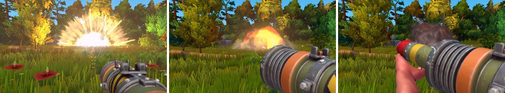
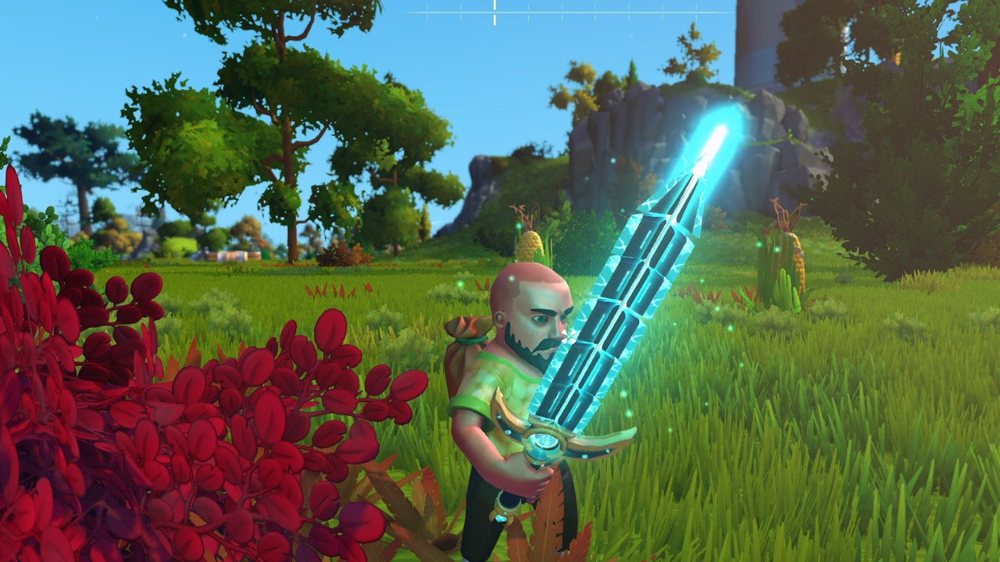
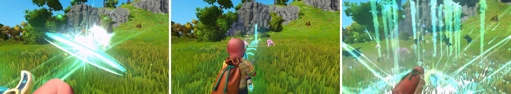
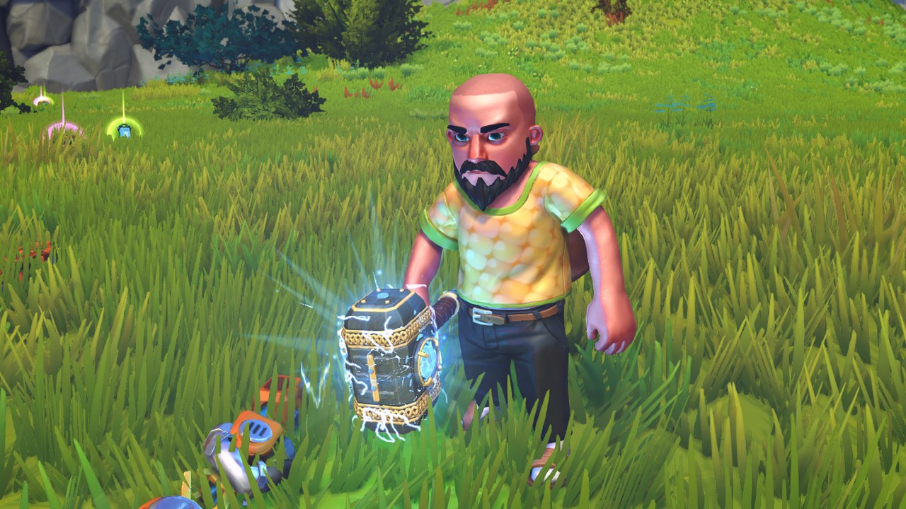
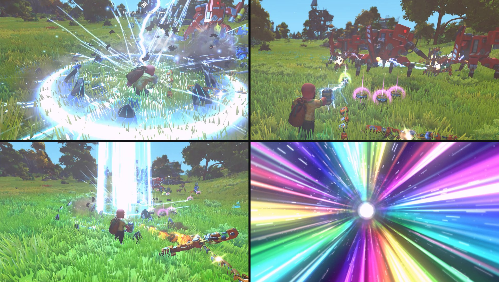
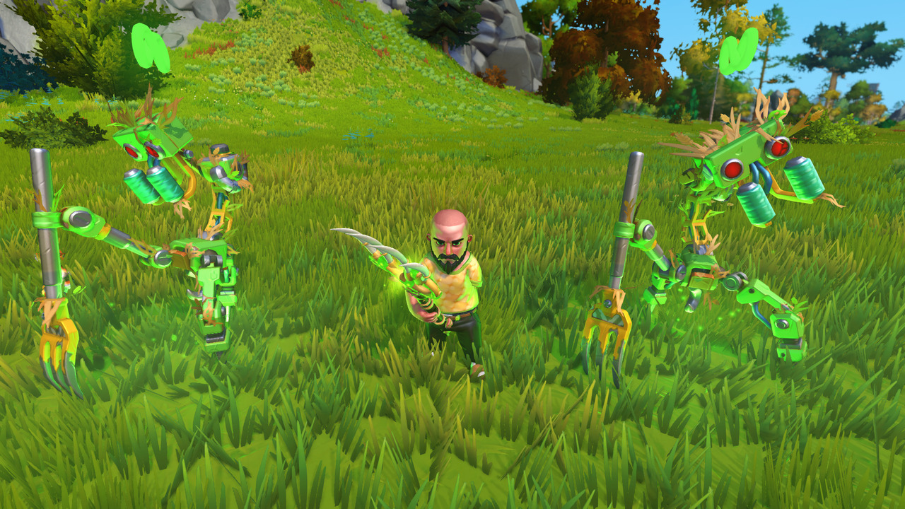
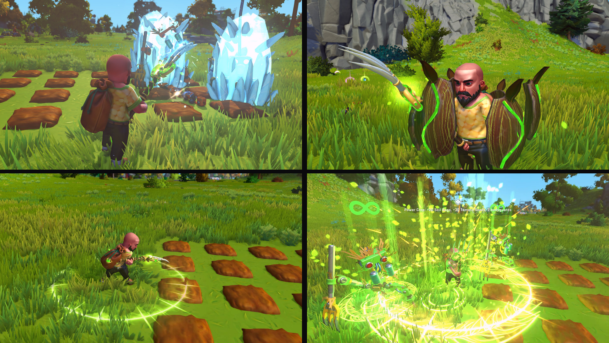

# WeaponsX

New weapons for **Scrap Mechanic Survival**, built on
[SMLoader](https://github.com/CazymirTM/SMLoader): the **Bazooka**, the
**Gravity Smasher**, the **Energy Sword**, the storm hammer **Gjadir** and the
**Infinity Fork**. More weapons are planned.

> Requires **SMLoader 1.5.0+** · Scrap Mechanic **1.0.7a** (Steam, Windows x64) ·
> Survival only · **every player in the world needs it**

## Bazooka

- **One rocket at a time.** It flies straight, explodes on impact, and the
  Bazooka reloads by itself in 2.5 seconds.
- **One rocket kills any normal robot.** The big six-legged Farmbot takes three
  direct hits. Bosses haven't been tested.
- **Mind the blast:** it also hurts you and breaks blocks.
- **Made for it:** its own model, icons, sounds, explosion and smoke, and its
  own shoulder-holding and reload animations in first and third person.

## Gravity Smasher

- **A shotgun with a clip of five Gravity Balls.** Each ball fires eight
  pellets. Press R to reload; it also reloads by itself when the clip is empty.
- **Hit a robot** and a black hole opens on it: every robot within 16 m is
  pulled in for 1.4 seconds, and most can't attack meanwhile.
- **Then it blows up.** The blast kills any normal robot it reaches. The big
  six-legged Farmbot takes three good hits; Lootbots survive it.
- **A miss does nothing**, so aim.
- **Mind the blast:** it also hurts you and breaks blocks.
- **Made for it:** its own model, sounds, black hole and violet explosion, a
  glowing core in your hands, own animations, and an ammo counter.

## Energy Sword

A floating blade from far beyond Earth.

- **Left mouse: slash.** A combo of three that hits every robot in front of
  you, as often as you like.
- **Right mouse: energy waves** that cut through every robot in their way, up to
  34 m. Each costs one Energy Flux, and the faster you fire, the stronger they
  get. One wave never takes more than 60% of a robot's health. After 18 waves
  it recharges for 30 seconds; R recharges it earlier.
- **Hold Q: teleport.** A glowing arrow shows where you will land. Aim closer or
  farther (up to 14 m), let go to teleport, right mouse to cancel. It doesn't go
  through walls. 13 seconds cooldown.
- **High jump:** about 5 m while you hold the sword, every 8 seconds, and you
  land without fall damage.
- **Ground smash:** fall 4 m or more after a high jump and you slam the ground.
  The higher the fall, the bigger the blast (3.6 to 7.5 m, 30 to 95 damage).
- **Made for it:** its own model, icons, sounds, effects and animations, and a
  panel with ammo and cooldowns.

## Gjadir

A storm hammer with 100 mana instead of ammo. The mana refills by itself; when
it runs out, only swings, the call and bare hands work until it is back to 20
(charging always works).

| Control | What it does |
|---|---|
| **Left mouse** | Five hits. The last one calls down thunder: 7.5 m, crater included (15 mana) |
| **Hold right mouse** | Aim with the arrow, let go to throw, up to 45 m. Left mouse cancels (12 mana) |
| **R** | Calls the thrown hammer back from anywhere, while its slot is selected |
| **Hold R** | Lightning chain: up to 8 robots. Stronger the longer you hold and the more robots it reaches (13 mana/s) |
| **Hold F** | Lightning strike from the sky, up to 60 m away. Let go to strike, click to cancel (25 mana, 15 s) |
| **Hold Q** | Charge: lightning fills its mana in about 4 seconds (12 s) |
| **Tap Q** | Bifrost: travel to a waystone (40 mana, 60 s). Needs [SMWaystones](https://github.com/CazymirTM/SMWaystones) |
| **Jump again in the air** | Fly where you look, up to 12 s: Space up, Ctrl down, Shift faster, Space twice to stop. No fall damage (9 s) |
| **Hammer away** | Bare hands: left mouse is a thunderclap, right mouse a stomp. Both throw robots about (4 s each) |

- **Kills make it stronger.** Every robot it destroys adds 1.2% damage, up to
  x2.2 at 100, and it glows brighter in five steps. It fades three in-game days
  after the first kill.
- **The throw and the lightning strike break blocks, trees and crates.** That
  includes your own buildings, so watch where you aim.
- **Made for it:** its own model, icon, sounds, lightning, Bifrost and
  animations in first and third person, and a panel with mana, kills and
  cooldowns.

## Infinity Fork

A farmer's fork that fights, farms and protects you.

| Control | What it does |
|---|---|
| **Left mouse** | Hits like a Sledgehammer, a little harder (26 instead of 20). Every swing also picks up all items within 8 m, even what you just smashed out of a crate |
| **Right mouse** | Block: three quarters less damage from the front. Raise it right before a hit to **parry**: no damage, and the robot is stunned for 5 s |
| **Tap Q** | **Plant Seeds**: pick one of your seeds and how many. Plants the free plots within 10 m, grow beds too |
| **Hold Q** | **Power Crop**: 20 soil bags, 30 tomato seeds and two bodyguards (15 min cooldown) |
| **F** | **Ice Aura** for 30 s: your hits freeze robots for 7 to 8 s and hurt them slowly (60 s cooldown) |
| **Tap R** | **Pump Up**: swing about twice as fast for 7 s (16 s cooldown) |
| **Hold R** | **Ironbark** for 60 s: +100 health and 20% armor (7 min cooldown) |

- **The bodyguards** are two green, glowing Haybots with 300 health each. They
  follow you for 15 minutes, also through waystones, and fight the robots around
  you. Your weapons don't hurt them, and they don't break crops or buildings.
- **Ironbark is no heal:** your share of health stays the same, 60 of 100 becomes
  120 of 200 and goes back when it ends.
- **It never hits young crops**, so you can swing in your own farm.
- **Made for it:** its own model, icon, sounds, ice, leaves, bark and animations
  in first and third person, and a panel with the cooldowns.

## Recipes

| Item | Craftbot recipe (unlocked from the start) |
|---|---|
| Bazooka | 50 Metal Block Level 3, 15 Component Kit, 10 Circuit Board, 10 Cable Roll |
| Rocket x2 | 10 Metal Block Level 2, 2 Circuit Board, 5 Gasoline, 4 Ember |
| Gravity Smasher | 50 Metal Block Level 3, 15 Component Kit, 15 Circuit Board, 20 Battery |
| Gravity Balls x5 | 15 Metal Block Level 2, 3 Circuit Board, 10 Battery, 5 Glow |
| Energy Sword | 35 Metal Block Level 3, 10 Component Kit, 10 Circuit Board, 15 Battery |
| Energy Flux x18 | 10 Metal Block Level 2, 2 Circuit Board, 6 Battery, 3 Glow |
| Gjadir | 75 Metal Block Level 3, 20 Component Kit, 20 Circuit Board, 30 Battery |
| Infinity Fork | 40 Metal Block Level 3, 10 Component Kit, 10 Circuit Board, 10 Battery |

Bazooka and Gravity Smasher: left mouse fires, right mouse aims.

## Install

1. Install [SMLoader](https://github.com/CazymirTM/SMLoader/releases) 1.5.0 or
   newer.
2. Download the WeaponsX zip from **Releases**.
3. Copy its `SMLoader` folder into your game folder and let it merge.
4. Load a Survival world and look in any Craftbot.

**Update from an older version:** replace `SMLoader\mods\WeaponsX.dll`.

**Uninstall:** delete `SMLoader\mods\WeaponsX.dll`. The weapons and their ammo
in your inventory are hidden, and come back if you reinstall. Do it while no
bodyguards are out and Ironbark is off.

## Good to know

- The first time you take a weapon out, it can be white for a few seconds
  while the game converts its textures.
- In first person the Gravity Smasher glows around its outline; the full glow
  shows in third person.
- Gjadir's flight uses W, A, S, D, Space, Ctrl and Shift, even if you changed
  those keys in the game.
- Gjadir does nothing to the Trashbot boss, and the Infinity Fork can't freeze or
  stun it.
- Planting a lot of crops starts raids, like always.
- **Co-op hasn't been tested yet, and neither have bosses.** Reports are
  welcome. In co-op everyone needs the same version.
- It works together with SMWaystones, SMJobsSystem and WokyMenu.
- The mod doesn't change any game files. The holding and reload animations are
  made on your computer from the game's own files; none of those are in the mod.
- After a game update the mod may stop working until it's updated (see
  `SMLoader\loader.log`).
- Back up your world before trying any mod.

## Bugs and suggestions

Open an [issue](https://github.com/CazymirTM/WeaponsX/issues). Please include
your `SMLoader\loader.log`.

## License

WeaponsX is **closed-source freeware**: free to use, but no re-uploads,
modified versions or reverse engineering. See [LICENSE](LICENSE). Please share
the link to this page instead of the zip.

Made with the help of AI (Claude Code for the code, models, sounds and
animations; ComfyUI for concepts, textures, effect sprites and icons).

*Not affiliated with or endorsed by Axolot Games.*
