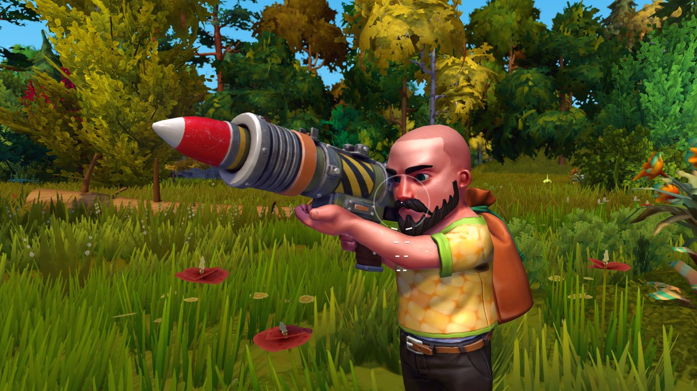
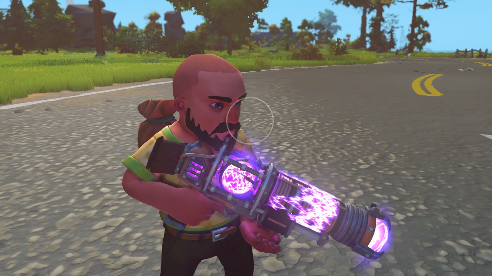
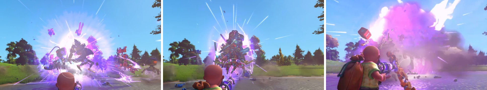

# WeaponsX

New weapons for **Scrap Mechanic Survival**, built on
[SMLoader](https://github.com/CazymirTM/SMLoader): the **Bazooka**, the
**Gravity Smasher** and the **Energy Sword**. More weapons are planned.

> Requires **SMLoader 1.5.0+** · Scrap Mechanic **1.0.7a** (Steam, Windows x64) ·
> Survival only · **every player in the world needs it**

## Bazooka

- **One rocket at a time.** It flies straight, explodes on impact, and the
  Bazooka reloads by itself in 2.5 seconds.
- **One rocket kills any normal robot.** The big six-legged Farmbot takes three
  direct hits. Bosses haven't been tested.
- **Mind the blast:** it also hurts you and breaks blocks.
- **Made for it:** its own model, icons, sounds, explosion and smoke, and its
  own shoulder-holding and reload animations in first and third person.

## Gravity Smasher

- **A shotgun with a clip of five Gravity Balls.** Each ball fires eight
  pellets. Press R to reload; it also reloads by itself when the clip is empty.
- **Hit a robot** and a black hole opens on it: every robot within 16 m is
  pulled in for 1.4 seconds, and most can't attack meanwhile.
- **Then it blows up.** The blast kills any normal robot it reaches. The big
  six-legged Farmbot takes three good hits; Lootbots survive it.
- **A miss does nothing**, so aim.
- **Mind the blast:** it also hurts you and breaks blocks.
- **Made for it:** its own model, sounds, black hole and violet explosion, a
  glowing core in your hands, own animations, and an ammo counter.

## Energy Sword

A floating blade from far beyond Earth.

- **Left mouse: slash.** A combo of three that hits every robot in front of
  you, as often as you like.
- **Right mouse: energy waves** that cut through every robot in their way, up to
  34 m. Each costs one Energy Flux, and the faster you fire, the stronger they
  get. One wave never takes more than 60% of a robot's health. After 18 waves
  it recharges for 30 seconds; R recharges it earlier.
- **Hold Q: teleport.** A glowing arrow shows where you will land. Aim closer or
  farther (up to 14 m), let go to teleport, right mouse to cancel. It doesn't go
  through walls. 13 seconds cooldown.
- **High jump:** about 5 m while you hold the sword, every 8 seconds, and you
  land without fall damage.
- **Ground smash:** fall 4 m or more after a high jump and you slam the ground.
  The higher the fall, the bigger the blast (3.6 to 7.5 m, 30 to 95 damage).
- **Made for it:** its own model, icons, sounds, effects and animations, and a
  panel with ammo and cooldowns.

## Recipes

| Item | Craftbot recipe (unlocked from the start) |
|---|---|
| Bazooka | 50 Metal Block Level 3, 15 Component Kit, 10 Circuit Board, 10 Cable Roll |
| Rocket x2 | 10 Metal Block Level 2, 2 Circuit Board, 5 Gasoline, 4 Ember |
| Gravity Smasher | 50 Metal Block Level 3, 15 Component Kit, 15 Circuit Board, 20 Battery |
| Gravity Balls x5 | 15 Metal Block Level 2, 3 Circuit Board, 10 Battery, 5 Glow |
| Energy Sword | 35 Metal Block Level 3, 10 Component Kit, 10 Circuit Board, 15 Battery |
| Energy Flux x18 | 10 Metal Block Level 2, 2 Circuit Board, 6 Battery, 3 Glow |

Bazooka and Gravity Smasher: left mouse fires, right mouse aims.

## Install

1. Install [SMLoader](https://github.com/CazymirTM/SMLoader/releases) 1.5.0 or
   newer.
2. Download the WeaponsX zip from **Releases**.
3. Copy its `SMLoader` folder into your game folder and let it merge.
4. Load a Survival world and look in any Craftbot.

**Update from 1.0 or 1.1:** replace `SMLoader\mods\WeaponsX.dll`.

**Uninstall:** delete `SMLoader\mods\WeaponsX.dll`. The weapons and their ammo
in your inventory are hidden, and come back if you reinstall.

## Good to know

- The first time you take a weapon out, it can be white for a few seconds
  while the game converts its textures.
- In first person the Gravity Smasher glows around its outline; the full glow
  shows in third person.
- **Co-op hasn't been tested yet, and neither have bosses.** Reports are
  welcome. In co-op everyone needs the same version.
- It works together with SMWaystones, SMJobsSystem and WokyMenu.
- The mod doesn't change any game files. The holding and reload animations are
  made on your computer from the game's own files; none of those are in the mod.
- After a game update the mod may stop working until it's updated (see
  `SMLoader\loader.log`).
- Back up your world before trying any mod.

## Bugs and suggestions

Open an [issue](https://github.com/CazymirTM/WeaponsX/issues). Please include
your `SMLoader\loader.log`.

## License

WeaponsX is **closed-source freeware**: free to use, but no re-uploads,
modified versions or reverse engineering. See [LICENSE](LICENSE). Please share
the link to this page instead of the zip.

Made with the help of AI (Claude Code for the code, models, sounds and
animations; ComfyUI for concepts, textures, effect sprites and icons).

*Not affiliated with or endorsed by Axolot Games.*
